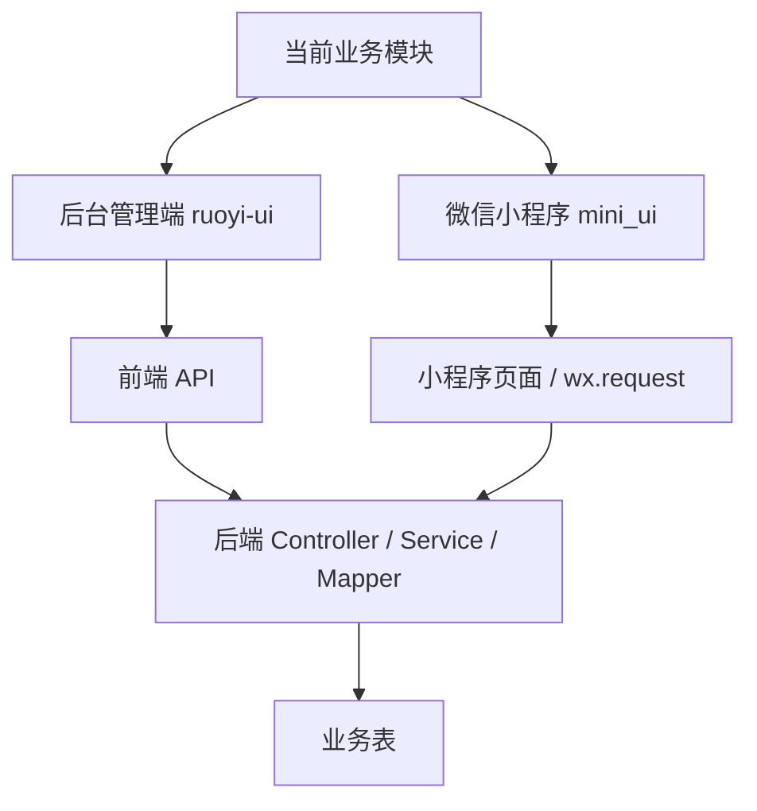
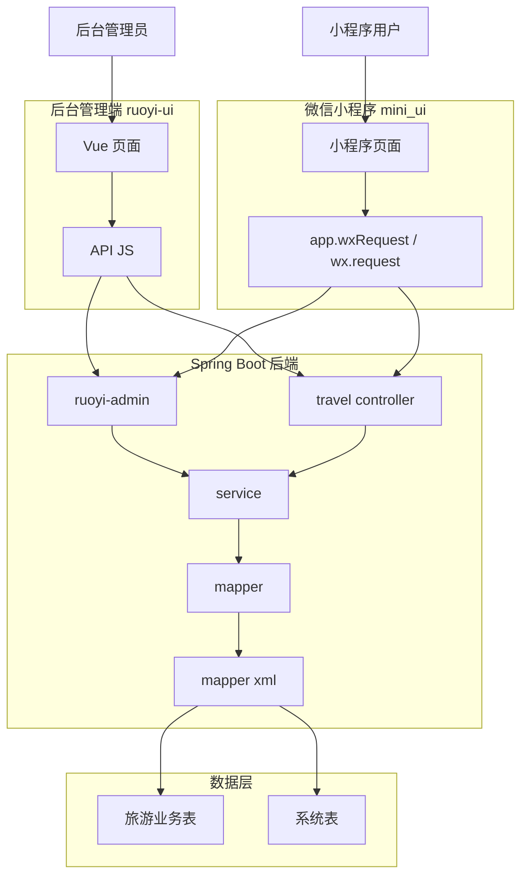
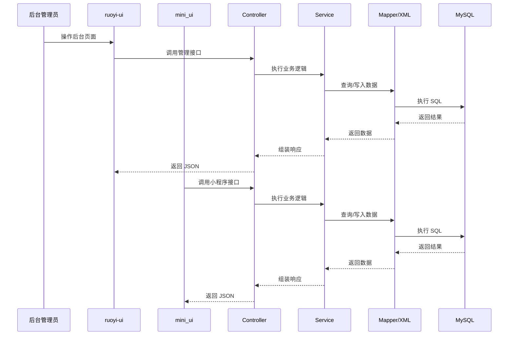
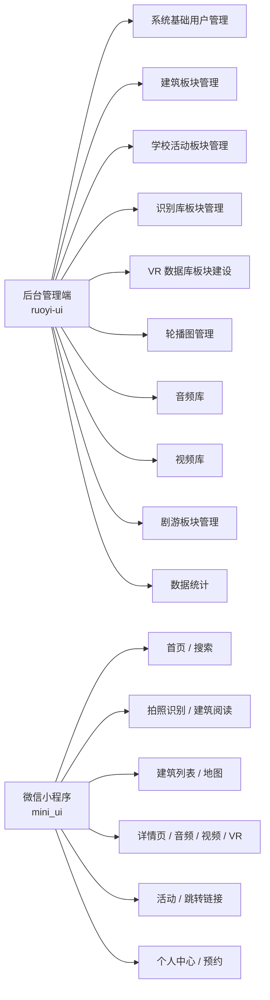
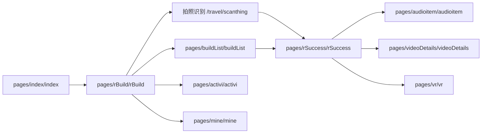
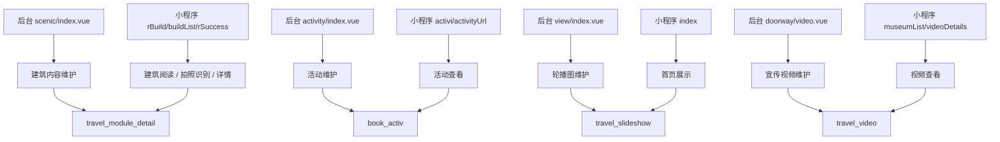

# 模块与平台关系图文文档

## 说明

- 本文档按“功能模块”整理当前代码对应的平台入口。
- 平台范围包括：
  - 后台管理端：`ruoyi-ui`
  - 小程序端：`mini_ui`
  - 后端服务：`travel`、`ruoyi-admin`、`ruoyi-system`
- 文档目标是把“模块 -> 平台 -> 页面 -> 接口 -> 后端代码 -> 业务表”串起来。

## 总体关系图



## 框架逻辑图



## 分层说明

- 展示层：
  - `ruoyi-ui` 负责后台管理页面
  - `mini_ui` 负责微信小程序页面
- 接口层：
  - 后台前端通过 `src/api/**/*.js` 调后端接口
  - 小程序通过 `app.wxRequest()` 和 `wx.request()` 调后端接口
- 控制层：
  - 系统能力主要在 `ruoyi-admin`
  - 旅游业务主要在 `travel/src/main/java/com/pz/travel/controller`
- 业务层：
  - 统一在 `service` 中处理业务逻辑、聚合数据、权限后的流程
- 数据层：
  - `mapper + mapper.xml` 负责 SQL 查询
  - 落到旅游业务表和若依系统表

## 端到端调用图



## 平台结构图



## 模块总览

| 模块 | 后台管理端页面 | 小程序端页面 | 后端主入口 |
| --- | --- | --- | --- |
| 系统基础用户管理 | `src/views/system/user/index.vue` | `app.js`、`pages/mine/mine.js` | `/system/user/*`、`/system/user/profile`、`/wx/user/{appid}/*` |
| 建筑板块管理 | `src/views/scenic/index.vue` | `pages/rBuild/rBuild.js`、`pages/buildList/buildList.js`、`pages/map/map.js`、`pages/rSuccess/rSuccess.js` | `/travel/backstage/*`、`/travel/*`、`/classification/*` |
| 学校活动板块管理 | `src/views/activity/index.vue` | `pages/activi/activi.js`、`pages/activityUrl/activityUrl.js` | `/activ/*`、`/travel/getActivityList` |
| 识别库板块管理 | `src/views/recognition/index.vue` | `pages/rBuild/rBuild.js`、`pages/rFail/rFail.js` | `/travel/backend/recognitionLibrary/*`、`/travel/scanthing` |
| VR 数据库板块建设 | `src/views/vr/index.vue` | `pages/vr/vr.js`、`pages/rSuccess/rSuccess.js` | `/travel/backstage/vr/*`、`/travel/scenicspot/{id}` |
| 轮播图管理 | `src/views/view/index.vue` | `pages/index/index.js` | `/travel/backend/slideshow/*`、`/travel/slideshow/random` |
| 音频库 | `src/views/scenic/index.vue` | `pages/rSuccess/rSuccess.js`、`pages/audioitem/audioitem.js` | `/travel/backstage/*`、`/travel/scenicspot/{id}` |
| 视频库 | `src/views/scenic/index.vue`、`src/views/doorway/video.vue` | `pages/videoDetails/videoDetails.js`、`pages/museumList/museumList.js`、`pages/rSuccess/rSuccess.js` | `/travelVideo/*`、`/travel/scenicspot/{id}` |
| 剧游板块管理 | `src/views/coverPics/index.vue`、`src/views/activity/index.vue`、`src/views/doorway/video.vue` | `pages/rBuild/rBuild.js`、`pages/activi/activi.js`、`pages/videoDetails/videoDetails.js` | `/travel/backstage/getCoverPicture/*`、`/activ/*`、`/travelVideo/*` |
| 数据统计 | `src/views/index.vue` | `pages/index/index.js`、`pages/rSuccess/rSuccess.js` | `/wxdata/*`、`/views/*` |

## 1. 系统基础用户管理

### 后台管理端

- 页面：`l:\shanxinongda\ruoyi-ui\src\views\system\user\index.vue`
- API：`l:\shanxinongda\ruoyi-ui\src\api\system\user.js`

### 小程序端

- 登录入口：`l:\shanxinongda\mini_ui\app.js`
- 个人中心页：`l:\shanxinongda\mini_ui\pages\mine\mine.js`
- 相关逻辑：
  - `wx.login`
  - `/wx/user/wx6caa96169ec9f475/login`
  - `/wx/user/wx6caa96169ec9f475/phone`
  - `/system/user/profile`

### 后端

- `l:\shanxinongda\ruoyi-admin\src\main\java\com\ruoyi\web\controller\system\SysUserController.java`
- `l:\shanxinongda\travel\src\main\java\com\pz\travel\controller\WxMaUserController.java`
- `l:\shanxinongda\ruoyi-system\src\main\java\com\ruoyi\system\service\ISysUserService.java`
- `l:\shanxinongda\ruoyi-system\src\main\java\com\ruoyi\system\service\impl\SysUserServiceImpl.java`
- `l:\shanxinongda\ruoyi-system\src\main\java\com\ruoyi\system\mapper\SysUserMapper.java`
- `l:\shanxinongda\ruoyi-system\src\main\resources\mapper\system\SysUserMapper.xml`

### 业务表

- `sys_user`
- `book_user`
- `sys_role`
- `sys_post`

## 2. 建筑板块管理

### 后台管理端

- 页面：`l:\shanxinongda\ruoyi-ui\src\views\scenic\index.vue`
- API：
  - `l:\shanxinongda\ruoyi-ui\src\api\travel\scenery.js`
  - `l:\shanxinongda\ruoyi-ui\src\api\travel\vr.js`

### 小程序端

- 建筑阅读首页：`l:\shanxinongda\mini_ui\pages\rBuild\rBuild.js`
- 建筑列表：`l:\shanxinongda\mini_ui\pages\buildList\buildList.js`
- 地图页：`l:\shanxinongda\mini_ui\pages\map\map.js`
- 建筑详情页：`l:\shanxinongda\mini_ui\pages\rSuccess\rSuccess.js`

### 小程序主要接口

- `/travel/list`
- `/travel/near`
- `/travel/scenicspot/list`
- `/classification/selectScenicByClassificatin`
- `/travel/scenicspot/{id}`

### 后端

- Controller：
  - `l:\shanxinongda\travel\src\main\java\com\pz\travel\controller\TravelController.java`
  - `l:\shanxinongda\travel\src\main\java\com\pz\travel\controller\TravelBackstageController.java`
  - `l:\shanxinongda\travel\src\main\java\com\pz\travel\controller\TravelClassificationController.java`
  - `l:\shanxinongda\travel\src\main\java\com\pz\travel\controller\HistoryHumanController.java`
- Service：
  - `TravelService.java`
  - `TravelBackstageService.java`
  - `TravelModuleService.java`
  - `TravelSubClassificationService.java`
  - `TravelJointService.java`
  - `HistoryHumanService.java`
- Mapper / XML：
  - `TravelScenicSpotMapper.java`
  - `TravelBackstageMapper.java`
  - `TravelJointMapper.java`
  - `TravelBackstageMapper.xml`
  - `TravelScenicSpotMapper.xml`
  - `TravelJointMapper.xml`

### 业务表

- `travel_module_detail`
- `travel_module`
- `travel_sub_classification`
- `travel_joint`
- `history_human`

### 关系图

```mermaid
flowchart LR
    A[后台 scenic/index.vue] --> B[api/travel/scenery.js]
    C[小程序 rBuild/buildList/map/rSuccess] --> D[/travel/* /classification/*]
    B --> E[TravelBackstageController]
    D --> F[TravelController / TravelClassificationController]
    E --> G[TravelBackstageService]
    F --> H[TravelService]
    G --> I[Mapper/XML]
    H --> I
    I --> J[travel_module_detail 等表]
```

## 3. 学校活动板块管理

### 后台管理端

- 页面：`l:\shanxinongda\ruoyi-ui\src\views\activity\index.vue`
- API：`l:\shanxinongda\ruoyi-ui\src\api\activity\index.js`

### 小程序端

- 活动列表：`l:\shanxinongda\mini_ui\pages\activi\activi.js`
- 活动链接页：`l:\shanxinongda\mini_ui\pages\activityUrl\activityUrl.js`
- 建筑阅读页中活动入口：`l:\shanxinongda\mini_ui\pages\rBuild\rBuild.js`

### 小程序主要接口

- `/travel/getActivityList`
- `/activ/list`

### 后端

- Controller：
  - `l:\shanxinongda\travel\src\main\java\com\pz\travel\controller\BookActivController.java`
  - `l:\shanxinongda\travel\src\main\java\com\pz\travel\controller\TravelController.java`
- Service：
  - `BookActivService.java`
  - `TravelService.java`
- Mapper：
  - `BookActivMapper.java`

### 业务表

- `book_activ`
- `travel_module`

## 4. 识别库板块管理

### 后台管理端

- 页面：`l:\shanxinongda\ruoyi-ui\src\views\recognition\index.vue`
- API：
  - `l:\shanxinongda\ruoyi-ui\src\api\travel\recognition.js`
  - `l:\shanxinongda\ruoyi-ui\src\api\travel\scenery.js`

### 小程序端

- 拍照识别页：`l:\shanxinongda\mini_ui\pages\rBuild\rBuild.js`
- 识别失败页：`l:\shanxinongda\mini_ui\pages\rFail\rFail.js`

### 小程序主要接口

- `/travel/scanthing`

### 后端

- Controller：
  - `l:\shanxinongda\travel\src\main\java\com\pz\travel\controller\TravelBackendController.java`
  - `l:\shanxinongda\travel\src\main\java\com\pz\travel\controller\TravelController.java`
- Service：
  - `TravelRecognitionLibraryService.java`
  - `TravelService.java`
  - `BaiduAIService.java`
- Mapper / XML：
  - `TravelRecognitionLibraryMapper.java`
  - `TravelRecognitionLibraryMapper.xml`

### 业务表

- `travel_recognition_library`
- `travel_module_detail`

## 5. VR 数据库板块建设

### 后台管理端

- 页面：`l:\shanxinongda\ruoyi-ui\src\views\vr\index.vue`
- API：`l:\shanxinongda\ruoyi-ui\src\api\travel\vr.js`

### 小程序端

- VR 页面：`l:\shanxinongda\mini_ui\pages\vr\vr.js`
- 建筑详情页中的 VR 入口：`l:\shanxinongda\mini_ui\pages\rSuccess\rSuccess.js`

### 小程序主要接口

- 建筑详情接口中携带 VR 信息：`/travel/scenicspot/{id}`

### 后端

- Controller：
  - `TravelBackstageController.java`
  - `TravelController.java`
- Service：
  - `TravelVrService.java`
  - `TravelService.java`
- Mapper / XML：
  - `TravelVrMapper.java`
  - `TravelVrMapper.xml`

### 业务表

- `travel_vr`
- `travel_module_detail`

## 6. 轮播图管理

### 后台管理端

- 页面：`l:\shanxinongda\ruoyi-ui\src\views\view\index.vue`
- API：`l:\shanxinongda\ruoyi-ui\src\api\travel\view.js`

### 小程序端

- 首页：`l:\shanxinongda\mini_ui\pages\index\index.js`

### 小程序主要接口

- `/travel/slideshow/random`

### 后端

- Controller：
  - `TravelBackendController.java`
  - `TravelController.java`
- Service：`TravelService.java`
- Mapper / XML：
  - `TravelSlideshowMapper.java`
  - `TravelSlideshowMapper.xml`

### 业务表

- `travel_slideshow`

## 7. 音频库

### 后台管理端

- 页面：`l:\shanxinongda\ruoyi-ui\src\views\scenic\index.vue`

### 小程序端

- 建筑详情页：`l:\shanxinongda\mini_ui\pages\rSuccess\rSuccess.js`
- 音频播放页：`l:\shanxinongda\mini_ui\pages\audioitem\audioitem.js`

### 小程序主要接口

- `/travel/scenicspot/{id}`

### 后端

- Controller：
  - `TravelBackstageController.java`
  - `TravelController.java`
- Service：
  - `TravelBackstageService.java`
  - `TravelService.java`
- Mapper / XML：
  - `TravelBackstageMapper.java`
  - `TravelBackstageMapper.xml`
  - `TravelScenicSpotMapper.java`
  - `TravelScenicSpotMapper.xml`

### 业务表

- `travel_module_detail`

### 关联字段

- `travelModelVideos`
- `audioUrl`

## 8. 视频库

### 后台管理端

- 页面：
  - `l:\shanxinongda\ruoyi-ui\src\views\scenic\index.vue`
  - `l:\shanxinongda\ruoyi-ui\src\views\doorway\video.vue`

### 小程序端

- 视频详情页：`l:\shanxinongda\mini_ui\pages\videoDetails\videoDetails.js`
- 视频列表页：`l:\shanxinongda\mini_ui\pages\museumList\museumList.js`
- 建筑详情页视频入口：`l:\shanxinongda\mini_ui\pages\rSuccess\rSuccess.js`

### 小程序主要接口

- `/travelVideo/list`
- `/travelVideo/detail`
- `/travel/scenicspot/{id}`

### 后端

- Controller：
  - `TravelVideoController.java`
  - `TravelBackstageController.java`
  - `TravelController.java`
- Service：
  - `TravelVideoService.java`
  - `TravelBackstageService.java`
  - `TravelService.java`
- Mapper / XML：
  - `TravelVideoMapper.java`
  - `TravelVideoMapper.xml`
  - `TravelBackstageMapper.java`
  - `TravelBackstageMapper.xml`

### 业务表

- `travel_video`
- `travel_module_detail`

## 9. 剧游板块管理

### 后台管理端

- 页面：
  - `l:\shanxinongda\ruoyi-ui\src\views\coverPics\index.vue`
  - `l:\shanxinongda\ruoyi-ui\src\views\activity\index.vue`
  - `l:\shanxinongda\ruoyi-ui\src\views\doorway\video.vue`

### 小程序端

- 建筑阅读页：`l:\shanxinongda\mini_ui\pages\rBuild\rBuild.js`
- 活动页：`l:\shanxinongda\mini_ui\pages\activi\activi.js`
- 视频页：`l:\shanxinongda\mini_ui\pages\videoDetails\videoDetails.js`
- 首页：`l:\shanxinongda\mini_ui\pages\index\index.js`

### 小程序主要接口

- `/travel/backstage/getCoverPicture/0`
- `/travel/backstage/getCoverPicture/1`
- `/travel/getActivityList`
- `/travelVideo/list`
- `/activ/list`

### 后端

- Controller：
  - `TravelBackstageController.java`
  - `BookActivController.java`
  - `TravelVideoController.java`
  - `TravelController.java`
- Service：
  - `TravelCoverService.java`
  - `BookActivService.java`
  - `TravelVideoService.java`
  - `TravelService.java`
- Mapper / XML：
  - `TravelCoverMapper.java`
  - `TravelCoverMapper.xml`
  - `BookActivMapper.java`
  - `TravelVideoMapper.java`
  - `TravelVideoMapper.xml`

### 业务表

- `travel_cover`
- `book_activ`
- `travel_video`

## 10. 数据统计

### 后台管理端

- 页面：`l:\shanxinongda\ruoyi-ui\src\views\index.vue`
- API：`l:\shanxinongda\ruoyi-ui\src\api\travel\home.js`

### 小程序端

- 首页：`l:\shanxinongda\mini_ui\pages\index\index.js`
- 建筑详情页：`l:\shanxinongda\mini_ui\pages\rSuccess\rSuccess.js`

### 小程序主要接口

- `/views/insertViews`
- `/views/insertScenicViews?scenicId=...`
- `/wxdata/scenic`
- `/wxdata/view`

### 后端

- Controller：
  - `WxDataController.java`
  - `TravelViewsController.java`
- Service：
  - `TravelViewsService.java`
  - `TravelScenicViewsService.java`
- Mapper / XML：
  - `WxDataMapper.java`
  - `WxDataMapper.xml`
  - `TravelViewsMapper.java`
  - `TravelViewsMapper.xml`
  - `TravelScenicViewsMapper.java`
  - `TravelScenicViewsMapper.xml`

### 业务表

- `travel_views`
- `travel_scenic_view`
- `travel_module_detail`

## 小程序用户主流程图



## 后台与小程序对应图


